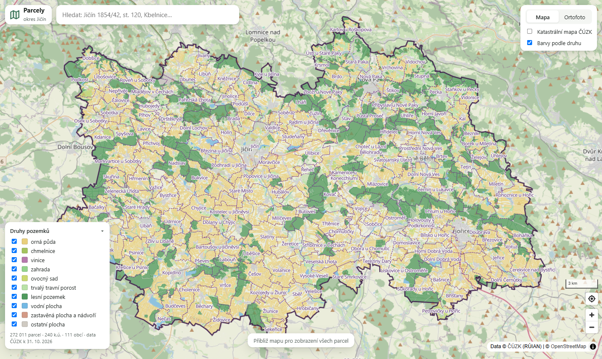
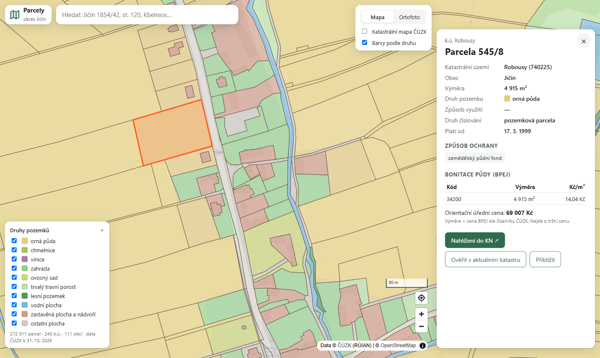

# Parcely okresu Jičín

Webová mapa **všech 272 011 parcel okresu Jičín** (111 obcí, 240 katastrálních území).
Po kliknutí na parcelu se zobrazí detail z katastru: číslo, KÚ, obec, výměra, druh pozemku,
způsob využití, ochrana, **bonitace půdy (BPEJ) s orientační úřední cenou**. Přímo z detailu jde
údaje **ověřit proti aktuálnímu stavu katastru (live WFS ČÚZK)**.





## Spuštění

Předpoklady: **Docker + Docker Compose** (nic dalšího, PHP i databáze běží v kontejnerech).

```bash
cp .env.example .env          # a nastav hesla DB_IMPORT_PASSWORD / DB_PASSWORD
docker compose up -d --build  # PostGIS + PHP-FPM + nginx
docker compose exec app php bin/import.php          # stáhne data ČÚZK a naimportuje celý okres (~2 min)
docker compose exec app php bin/warm-tiles.php      # volitelné: předgeneruje všechny dlaždice (~25 s)
```

Aplikace běží na **http://localhost:8080**.

Další užitečné příkazy:

```bash
docker compose exec app php bin/import.php --obce=572659,573051   # jen vybrané obce (kódy RÚIAN)
docker compose exec app php bin/warm-tiles.php --min=8 --max=13   # jen nižší zoomy (rychlé)
composer install && composer test                                  # unit testy (lokální PHP 8.3)
```

| Komponenta | Verze |
|---|---|
| PHP | 8.3 (FPM, rozšíření `pdo_pgsql`, `zip`, `xmlreader`, `dom`, `curl`) |
| Databáze | PostgreSQL 16 + PostGIS 3.4 |
| Web server | nginx 1.27 |
| Frontend | MapLibre GL JS 4.7 (z CDN, bez build kroku) |
| Závislosti PHP | žádné runtime; PHPUnit 11 jen pro testy |

Konfigurace je v `.env` (viz `.env.example`): přístupy k DB, kód okresu (`DISTRICT_CODE=3604`
→ dá se importovat i jiný okres), datum datové sady VFR, limit live dotazů.

## Co aplikace umí

- **Celý okres plynule** – vektorové dlaždice s generalizací podle zoomu, vykreslení přes WebGL.
- **Detail parcely** – vč. způsobu ochrany a BPEJ s cenou dle oficiálního číselníku ČÚZK.
- **Live ověření** – porovná uložená data s aktuálním INSPIRE WFS ČÚZK („změnilo se od importu?“).
- **Vyhledávání** – `Jičín 1854/42`, `st. 120`, jen číslo (napříč okresem), nebo název KÚ
  (bez diakritiky, `kbel` → Kbelnice u Jičína). Ovládání klávesnicí.
- **Barvy podle druhu pozemku** + legenda jako filtr (např. zobraz jen ornou půdu a TTP).
- **Podklady**: OpenStreetMap, ortofoto ČÚZK, překryv katastrální mapy (WMS ČÚZK).
- **Sdílitelné odkazy** – stav mapy v URL (`#mapa=z/lat/lon`), vybraná parcela v `?parcela=ID`.
- **Odkaz do Nahlížení do KN** (vlastníci, LV – ty ČÚZK zdarma strojově neposkytuje).
- **Responzivní** – na mobilu je detail jako spodní panel, ovládání dotykem.

## Architektura

```
prohlížeč (MapLibre) ──► nginx ──► var/cache/tiles/{z}/{x}/{y}.pbf      cache hit: bez PHP i DB
                              └──► php-fpm  public/index.php            cache miss + API
                                      ├──► PostGIS (read-only role)
                                      └──► WFS ČÚZK (live detail, cache 1 h)

bin/import.php ──► vdp.cuzk.cz (VFR) + services.cuzk.cz (číselníky) ──► PostGIS
```

PHP kód je rozdělený do vrstev, závislosti vedou jen dovnitř:

```
src/
├── Domain/          čistá doména bez SQL/HTTP: Parcel, ParcelNumber, BpejValuation, TileCoordinate,
│                    rozhraní ParcelRepository, CadastreCatalog, LiveCadastre, TileProvider, TileCache
├── Application/     use-cases: GetParcelDetail, SearchParcels, CompareWithLiveCadastre, GetTile,
│                    WarmTileCache, ImportDistrict (+ porty CadastreSource, CodeListSource, ImportStore)
├── Infrastructure/  implementace rozhraní: Persistence (PostGIS), Cuzk (VFR parser, WFS, číselníky),
│                    Cache (soubory), Http (curl), Logging (JSON na stderr)
├── Http/            Router, Request/Response, controllery, Presenter (doména → JSON)
├── Config.php       konfigurace z prostředí
└── Kernel.php       composition root – jediné místo, kde se skládají závislosti
```

- Controllery a use-cases nevědí nic o PostGISu ani o ČÚZK → testují se s in-memory implementacemi.
- Router přijímá jen číselné parametry, takže controllery dostávají už validovaný vstup.
- Bez frameworku: aplikace má 5 endpointů, vlastní router má 40 řádků a je vidět, co dělá.

### API

| Endpoint | Popis |
|---|---|
| `GET /tiles/{z}/{x}/{y}.pbf` | Mapbox Vector Tile (vrstvy `parcels`, `cadastral_areas`, `cadastral_labels`, `district`) |
| `GET /api/parcels/{id}` | detail parcely vč. GeoJSON geometrie |
| `GET /api/parcels/{id}/live` | porovnání s aktuálním stavem (WFS ČÚZK) |
| `GET /api/search?q=…` | vyhledání parcely / KÚ |
| `GET /api/meta` | legenda, rozsah dat, datum datové sady |

## Výkon

Naměřeno lokálně (Docker Desktop, Windows), celý okres:

| | |
|---|---|
| Import 111 obcí / 272 tis. parcel | ~105 s (stažení + parsování + zápis) |
| Parsování VFR obce Jičín (17 tis. parcel, 38 MB XML) | 1,5 s, 2 MB paměti (streaming) |
| Předgenerování všech dlaždic okresu (z8–15, 3 255 ks, 53 MB) | ~24 s |
| Dlaždice z cache (nginx) | ~5–10 ms |
| Dlaždice poprvé (PHP + PostGIS) | 50–300 ms |
| Velikost dlaždice při pohledu na celý okres (z10) | průměr 35 kB, max 185 kB (gzip) |
| Vykreslených parcel při pohledu na celý okres | ~18 tis. (zbytek je pod 2 px) |
| Režie PHP požadavku | ~10 ms (OPcache, classmap autoload) |

Jak se k tomu došlo:
1. **Generalizace podle zoomu** (`PostGisTileProvider`): pod zoomem 14 se vynechávají parcely
   menší než 2×2 px (podle skutečné výměry, ne plochy v Mercatoru), geometrie se zjednodušuje
   na 1 px a dlaždice mají extent 1024 místo 4096. Největší dlaždice na z10 klesla z 1,1 MB na 340 kB
   (185 kB gzip).
2. **Dvouúrovňová cache dlaždic** – PHP zapíše dlaždici do `var/cache/tiles/z/x/y.pbf`, nginx ji příště
   servíruje přes `try_files` bez PHP. Zápis je atomický (temp + rename). Import cache maže.
3. **Kód zapečený do image** + `opcache.validate_timestamps=0` + `--classmap-authoritative` – režie
   PHP klesla ze ~200 ms (bind mount z Windows) na ~10 ms.
4. **Frontend**: hover přes `feature-state` (bez překreslení dat), filtr druhů přes `setFilter`,
   čísla parcel jen od zoomu 17, debounce + `AbortController` u vyhledávání.

## Bezpečnost

- Web se k DB připojuje **read-only rolí** (`SELECT` + `statement_timeout 15s`); zapisuje jen import.
- Všude **prepared statements**; LIKE vzory escapované; vstupy validované routerem / value objekty.
- Live endpoint volá ČÚZK **jen pro ID existující v naší DB** (žádné SSRF), má **rate limit**
  (30/min/IP) a cache.
- Frontend vkládá data výhradně přes `textContent` (žádné `innerHTML`), styly přes CSSOM.
- nginx: **CSP** (jen vlastní origin + konkrétní mapové služby), `X-Frame-Options`, `nosniff`,
  `Referrer-Policy`, jen `GET` na API, skrytá verze serveru i PHP. MapLibre ze CDN se **SRI hashem**.
- Chyby se logují (`docker compose logs app`), klient dostane jen obecnou hlášku bez stack trace.
- Porty DB i webu jsou publikované jen na `127.0.0.1`; hesla jen v `.env` (není v gitu).

## Testy

`composer test` – 50 testů: převod GML → WKT (vč. oblouků a kružnic), streaming parser VFR
na vzorovém XML, parsování parcelních čísel a vyhledávacích dotazů, BPEJ ocenění, router
(odmítnutí nečíselných parametrů), cache dlaždic a rate limiter, parsování odpovědí WFS,
use-case importu a dlaždic s in-memory implementacemi.

---

## Zápisník

### Rozhodnutí

**Data předem, ne live.** WFS ČÚZK vrací pro bbox dotaz maximálně jednotky objektů
(`Response truncated … max. 1 for this feature`) – zobrazit z něj celý okres nejde a i kdyby,
každý pohyb mapou by čekal na cizí server. Proto import z **výměnného formátu RÚIAN** (soubory
`OB_<kód>_UKSH` za každou obec, aktualizace měsíčně). Live služba se hodí jen na jednu parcelu –
tak ji používám v „Ověřit v aktuálním katastru“.

**RÚIAN VFR místo INSPIRE GML.** VFR má navíc druh pozemku, způsob využití, ochranu a BPEJ –
přesně to, co je pro výkup pozemků zajímavé. INSPIRE parcela má jen číslo, výměru a geometrii.

**Celý okres.** Architektura je stejná pro 4 KÚ i 240, a výkon je potřeba řešit tak jako tak.
Import se dá omezit na vybrané obce (`--obce=`).

**PostGIS + vektorové dlaždice.** `ST_AsMVT` je standard, generalizace se dělá v SQL a prohlížeč
dostane jen to, co je vidět. Alternativa „poslat GeoJSON“ by u 272 tis. polygonů znamenala stovky MB.
Uvažoval jsem i čisté PHP + SQLite s vlastním MVT enkodérem – víc vlastního geo kódu a rizika bez
přínosu pro uživatele.

**Bez frameworku, ale s vrstvami.** Zadání preferuje čisté PHP. Aby to nebyl „jeden index.php“,
je kód rozdělený na Domain / Application / Infrastructure / Http s rozhraními a jedním composition
rootem (`Kernel`). Na pohovoru se dá snadno ukázat, kudy jde požadavek.

**Logování jen tam, kde chybí informace.** Každý požadavek i se status kódem a časem už zapisuje
access log nginxu (včetně 429 z rate limitu), takže PHP loguje jen to, co odtamtud vyčíst nejde:
neošetřené výjimky (s metodou, cestou a řetězem příčin), výpadek WFS ČÚZK (původní chyba curl, která
se jinak ztratí v obecném 502), nečekanou odpověď WFS (prvních 1000 znaků, aby byla vidět změna
schématu) a pád importu se stack trace. Formát je JSON na řádek na stderr, takže to Docker posbírá
bez konfigurace a dá se to grepovat i poslat do Loki/ELK. Monolog jsem nepřidal: dvě úrovně a jeden
výstup jsou na pár desítek řádků, rozhraní `Logger` je v aplikační vrstvě a případná výměna je jedna řádka v `Kernel`.

**Bez admin rozhraní.** Data nikdo ručně neupravuje, jediná správcovská akce je import (CLI).
Admin by znamenal přihlašování, sessions, CSRF – víc útočné plochy bez užitku. Stav dat (datum
datové sady, počty) je vidět přímo v legendě mapy.

**Orientační úřední cena z BPEJ.** Číselník BPEJ ČÚZK obsahuje cenu Kč/m². Součet výměra × cena
je cena dle cenového předpisu, ne tržní – v UI je to tak i popsané. Pro výkup je to rychlé
srovnání „bonity“ pozemků.

### Co mě překvapilo

- **Oblouky v geometrii.** Hranice parcel ve VFR obsahují `gml:ArcString` i `gml:Circle` (např. kruhové
  stavby). `ST_GeomFromGML` je neumí, proto vlastní převod do WKT s `CIRCULARSTRING`/`COMPOUNDCURVE`
  a linearizace v PostGISu (`ST_CurveToLine`). Kružnice zadaná 3 body se musí dopočítat
  (střed → protilehlý bod).
- **Kontejner se jmenuje stejně jako prvek.** Ve VFR je `<vf:KatastralniUzemi>` zároveň obal seznamu
  i jednotlivé KÚ – rozlišuji podle `gml:id`.
- **Číselníky jsou ve Windows-1250** a ceny BPEJ jsou v samostatném číselníku ISKN, ne ve VFR.
- **Bind mount na Windows** zpomalil každý PHP požadavek na ~200 ms (stat souborů přes hranici VM).
  Řešením bylo zabudovat kód do image – což je stejně správně pro produkci.
- **nginx `add_header` se v `location` nedědí** – po přidání `Cache-Control` k assetům zmizela CSP.
  Hlavičky jsou proto ve sdíleném snippetu.
- CSP zablokovala i `style="…"` vytvořené z JS – barvy legendy se nastavují přes CSSOM.
